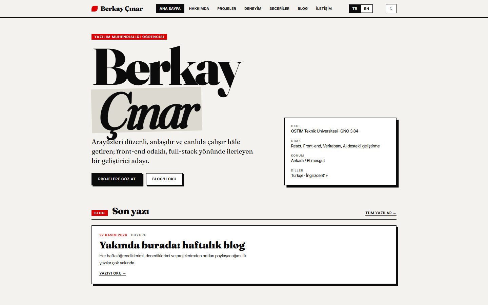
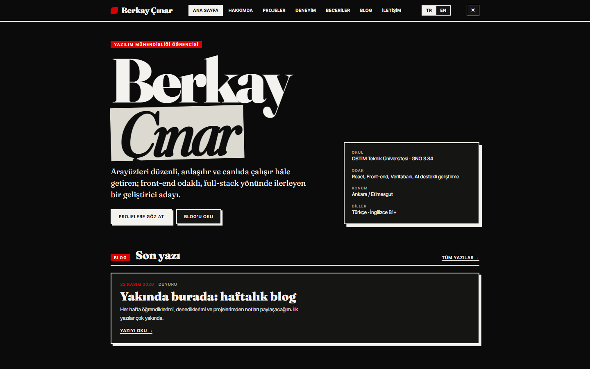
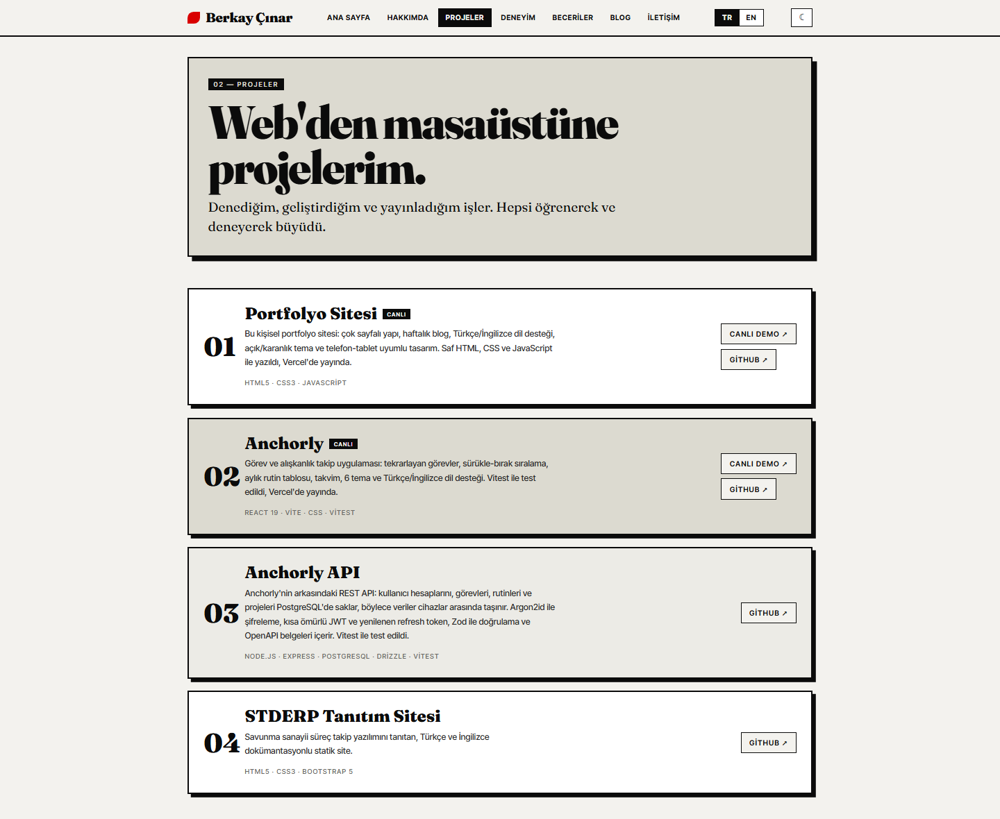
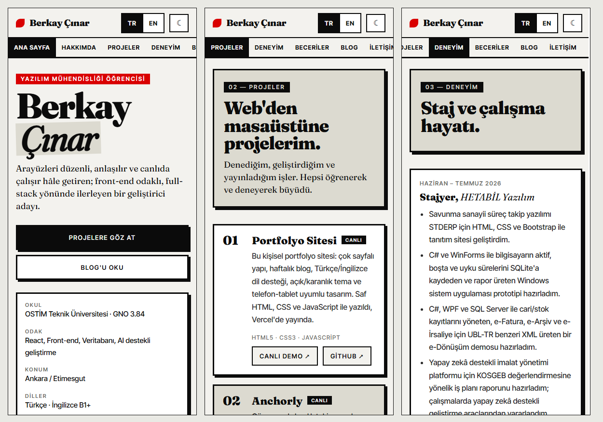

# Berkay Çınar — Portfolyo Sitesi

Yazılım Mühendisliği öğrencisi olarak projelerimi, deneyimlerimi ve haftalık yazılarımı paylaştığım kişisel portfolyo sitesi.
Saf HTML, CSS ve JavaScript ile yazıldı; derleme ya da kurulum gerektirmez.

**Canlı site:** https://berkaycinar.vercel.app

Tasarım dili: dergi kapağı estetiği. Kalın çerçeveler, sert gölgeler, büyük tipografi (Fraunces + Inter Tight).

## Özellikler

- **Çok sayfalı yapı:** Ana Sayfa, Hakkımda, Projeler, Deneyim, Beceriler, Blog, İletişim
- **Haftalık blog:** yazı listesi, tek yazı sayfası, önceki/sonraki gezintisi
- **İki dil:** Türkçe / İngilizce anahtarı, seçim hatırlanır
- **Açık / karanlık tema:** sistem temasına uyar, seçim hatırlanır
- **Duyarlı tasarım:** telefon, tablet ve masaüstünde çalışır; hareket azaltma ayarına saygı gösterir

## Ekran görüntüleri

**Açık ve karanlık tema**

| Açık tema | Karanlık tema |
|---|---|
|  |  |

**Projeler sayfası**



**Telefon görünümü**



## Çalıştırma

Kurulum yok. Bağlantılar `.html` uzantısız (`/about`, `/blog`) olduğu için dosyayı çift tıklayarak değil, yerel sunucuyla açın:

```bash
npx serve
```

## Klasör yapısı

```
.
├─ index.html, about.html, projects.html,
│  experience.html, skills.html, blog.html,
│  post.html, contact.html     → sayfalar
├─ content/
│  ├─ data.js                   → projeler, deneyim, beceriler, sertifikalar, hakkımda
│  └─ posts.js                  → blog yazıları
├─ assets/
│  ├─ css/style.css             → tasarım (açık ve karanlık tema dahil)
│  ├─ js/                       → site.js, blog.js, i18n.js, theme.js
│  └─ Berkay_Cinar_CV.pdf
├─ sitemap.xml, robots.txt      → arama motoru dosyaları
└─ docs/
   ├─ GUIDE.md
   └─ screenshots/             → README ekran görüntüleri
```

## Yayınlama

Site Vercel üzerinde yayında: https://berkaycinar.vercel.app
Statik bir site olduğu için GitHub Pages ya da Netlify ile de doğrudan yayınlanabilir.
Ek ayar gerekmez; yayın kökü deponun kendisidir.

## Teknolojiler

HTML5 · CSS3 · JavaScript (ES5, bağımlılıksız) · Google Fonts

## İletişim

[github.com/berkaycinar-dev](https://github.com/berkaycinar-dev) · berkaycnr6767@gmail.com
